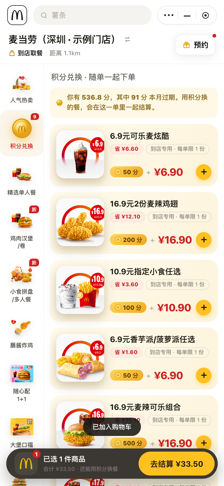
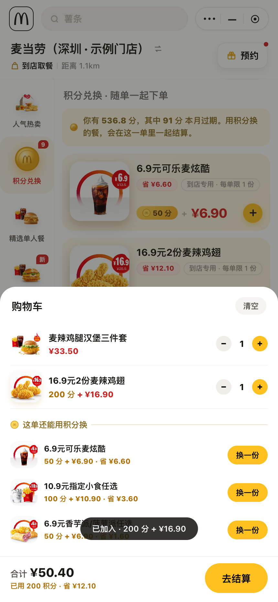
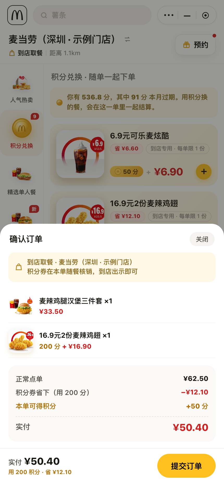
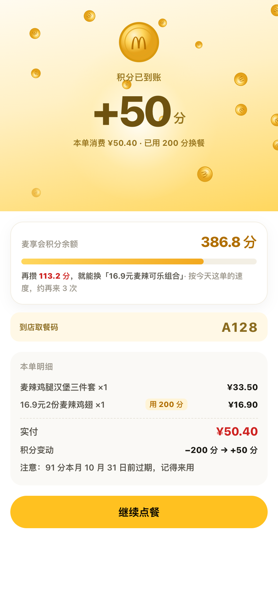

<div align="center">
  
  <h1>积分宝 · Points Pal</h1>
  <p><b>点单的时候，顺手把积分花掉。</b></p>
  <p>一个基于麦当劳 MCP 的 <b>WorkBuddy Skill</b>：把积分兑换券搬进点餐流程，在你决定吃什么的那一刻出现。</p>
  <p>接上<b>你自己的</b>麦当劳 MCP Token，它读的就是你附近门店的实时菜单、你自己账户的真实积分。</p>
  <p>
    <a href="USER_FLOW.md"><b>🚀 用户使用流程</b></a>
    &nbsp;·&nbsp;
    <a href="#-上手"><b>⚡ 上手</b></a>
    &nbsp;·&nbsp;
    <a href="#-在你自己的-workbuddy-里用起来推荐"><b>🧩 装进 WorkBuddy</b></a>
    &nbsp;·&nbsp;
    <a href="#-可分享的产物"><b>📄 报告示例</b></a>
    &nbsp;·&nbsp;
    <a href="#-实测发现官方文档没写的"><b>🔍 实测发现</b></a>
  </p>
  <p>
    
    
    
    
    
    
  </p>
</div>

---

> 你攒了 **13611** 分，用掉 **12159** 分，**过期扔掉 915** 分。
> 剩下那 **536 分**，正躺在一顿还没点的饭里。

麦当劳的积分**不能单独兑换**。它换到的是一张「到店专用」的特价购买券——`50 分 + ¥6.9` 换一份可乐麦炫酷，`200 分 + ¥16.9` 换 2 份麦辣鸡翅——而且**必须和这顿饭一起下单**才生效。

而这张券的入口，在积分商城的最深处。

于是最常见的结局是：**券一直躺在商城里，直到过期。**

**积分宝只做一件事：把积分券搬进点餐流程，在你决定吃什么的那一刻出现。**

<br>

<div align="center">
  
  
  
  
</div>

<br>

## 🧩 它解决的三个断点

| 断点 | 现状 | 积分宝的做法 |
|---|---|---|
| **找不到** | 积分券在积分商城，点餐时不会打开 | 券作为「积分兑换」分类**长在菜单里**，人气热卖顶部另有入口 |
| **想不起** | 券必须随单核销，出了结算页就作废 | 结算面板常驻「**这单还能用积分换**」，只列你换得起的 |
| **不知道换哪张** | 券名字雷同，效率差到 12 倍 | 按「**每积分省多少**」排序，并标出「省 ¥x」 |

## 💡 核心洞察：同样是 1 分，价值差 12 倍

积分换到的不是免费餐，而是**特价购买资格**——所以「划不划算」是可以精确算出来的。以下是本项目实测核验的 9 张有效券（`省钱 ÷ 消耗积分`）：

| 排序 | 券 | 消耗积分 | 券价 | 单点价 | 省 | **每积分** |
|:--:|---|:--:|:--:|:--:|:--:|:--:|
| 1 | 6.9元可乐麦炫酷 | 50 | ¥6.9 | ¥13.5 | ¥6.6 | **¥0.132** |
| 2 | 16.9元2份麦辣鸡翅 | 200 | ¥16.9 | ¥29.0 | ¥12.1 | ¥0.061 |
| 3 | 10.9元指定小食任选 | 100 | ¥10.9 | ¥14.5 | ¥3.6 | ¥0.036 |
| 4 | 6.9元香芋派/菠萝派任选 | 50 | ¥6.9 | ¥8.5 | ¥1.6 | ¥0.032 |
| 5 | 16.9元麦辣可乐组合 | 500 | ¥16.9 | ¥32.0 | ¥15.1 | ¥0.030 |
| 6 | 17.9元板烧可乐组合 | 500 | ¥17.9 | ¥33.0 | ¥15.1 | ¥0.030 |
| 7 | 21.9元巨无霸可乐组合 | 800 | ¥21.9 | ¥36.0 | ¥14.1 | ¥0.018 |
| 8 | 10.9元指定小食任选 | 200 | ¥10.9 | ¥14.0 | ¥3.1 | ¥0.016 |
| 9 | 3.9元圆筒冰淇淋 | 100 | ¥3.9 | ¥5.0 | ¥1.1 | **¥0.011** |

两个用户几乎不可能自己发现的事实：

1. **省下差不多的钱，积分差 4 倍**——省 ¥12.1 用 200 分，省 ¥14.1 用 800 分。
2. **两张券名字一模一样**——都叫「10.9元指定小食任选」，但 100 分那张省 ¥3.6，200 分那张只省 ¥3.1。**便宜的那张反而更划算。**

> 单点价取自同一门店菜单的实时价格（`query-meals`），不是估算值。券的积分与券价来自 `mall-points-products`。完整核价表见 [`fixtures/coupon_reference.json`](fixtures/coupon_reference.json)，可逐条审计。

## ⚡ 上手

### ① 在你自己的 WorkBuddy 里用起来（推荐）

三步，全程只用**你自己的 Token**。

**第 1 步 · 申请 Token** —— 到 [麦当劳 MCP 控制台](https://open.mcd.cn/mcp) 申请属于你自己的 MCP Token。

**第 2 步 · 接入 WorkBuddy** —— 左侧栏【专家·技能·连接器】→【连接器】→ 右上角【自定义连接器】→【配置 MCP】，粘贴下面这段（把 `${MCD_MCP_TOKEN}` 换成你的 Token），保存后把 `mcd-mcp` 启用：

```json
{
  "mcpServers": {
    "mcd-mcp": {
      "type": "streamablehttp",
      "url": "https://mcp.mcd.cn",
      "headers": { "Authorization": "Bearer ${MCD_MCP_TOKEN}" }
    }
  }
}
```

**第 3 步 · 装上 Skill，说一句话** —— 把本仓库放进 `~/.workbuddy/skills/mcd-points-pal/`，然后直接说：

> 我在深圳，想点一份麦辣鸡腿汉堡三件套，看看积分能换点啥

积分宝会拉**你附近门店**的实时菜单、**你自己账户**的真实积分，算清这一单该用哪张券、能省多少、下单后还能再攒多少。

> 🔒 仓库里**不含任何真实 Token、密钥或账号凭证** —— 配置示例只用环境变量占位符 `${MCD_MCP_TOKEN}`。Token 只存在你自己的环境里，不会写进任何文件。

### ② 可选：不想配 Token，先看效果

```bash
git clone https://github.com/limingyank-H/mcd-points-pal.git
cd mcd-points-pal
PYTHONPATH=src python3 -m mcd_points_pal serve
```

浏览器会自动打开 `http://127.0.0.1:8765`。没有 Token 也能进 —— 这时用的是
[`fixtures/`](fixtures/) 里固化下来的**真实快照**（界面会明确标注采集时间）。

想换成实时数据，在页面右上角点「接入实时」，粘贴**你自己的** Token 即可。此时它会：
**搜索你附近任何一家门店 → 拉那家店的实时菜单 → 取你账户的真实积分 →
按那家店的价格算每一张券省多少 → 提交前再调一次麦当劳官方 `calculate-price` 核价。**

换了门店，数字就跟着变 —— 下面是同一天两家店的真实对比：

| | 门店 A（快照） | 门店 B（实时） |
|---|:--:|:--:|
| 6.9元可乐麦炫酷省 | ¥6.60 | **¥6.10** |
| 16.9元2份麦辣鸡翅省 | ¥12.10 | **¥13.10** |
| 每积分价值差 | 12.0 倍 | 11.1 倍 |

Token 只存在本地服务进程的内存里，不写任何文件，服务只监听 `127.0.0.1`。

### ③ 可选：命令行（纯标准库，零依赖）

```bash
PYTHONPATH=src python3 -m mcd_points_pal list
PYTHONPATH=src python3 -m mcd_points_pal advise --cart 9900005456:1,P17078:1
PYTHONPATH=src python3 -m mcd_points_pal checkout --cart 9900005456:1,P17078:1

# 接上你自己的 Token，改为读实时数据（--live 是全局参数，放在子命令前）
export MCD_MCP_TOKEN=你的Token
PYTHONPATH=src python3 -m mcd_points_pal --live list
PYTHONPATH=src python3 -m mcd_points_pal --live tools   # 列出 MCP 提供的全部 Tool

# 或作为包安装，之后直接用 mcd-points-pal 命令（省掉 PYTHONPATH）
pip install . && mcd-points-pal demo
```

> ⚠️ 用 `pip install .` 的话，**请在 clone 出来的仓库目录里运行命令**。
> 离线快照（`fixtures/`）留在仓库根，包外不带 —— 换了目录会提示你
> 用 `--fixtures` 指定路径，或改走 `--live` 实时模式。应用的静态页面
> 已随包一起安装，`serve` 在任何目录都能起来。

> 不知道从哪下手？看一页纸的 [**用户使用流程 →**](USER_FLOW.md)

`list` 会打出效率榜，并在最后给出结论：

```
省同样的钱，积分可以差 12.0 倍：
    6.9元可乐麦炫酷：50 分省 ¥6.60（每积分 ¥0.1320）
    3.9元圆筒冰淇淋：100 分省 ¥1.10（每积分 ¥0.0110）

已剔除 15 张「假上架」券（downTime 已过，但接口 status 仍是 2 上架）
```

给它一个购物车，它会算这单怎么用积分：

```
$ PYTHONPATH=src python3 -m mcd_points_pal advise --cart 9900005456:1,P17078:1

  本单：2 件
             麦辣鸡腿汉堡三件套 ×1　¥33.50
    [积分券] 16.9元2份麦辣鸡翅 ×1　¥16.90　(200 分)

    正常点单            ¥62.50
    积分券省下（用 200 分）  −¥12.10
    预计本单可得        +50 分
    实付                ¥50.40

  还能顺手换（余额 536.8 分，其中 91 分本月过期）：
      6.9元可乐麦炫酷       　50 分 + ¥6.90　省 ¥6.60　每积分 ¥0.1320

  积分：536.8 → 用掉 200 → 可得 50 → 结余 386.8
  下一次目标：再攒 113.2 分可换「16.9元麦辣可乐组合」（500 分）
              按今天这单的速度，约再来 3 次。

  提醒：积分券是「随单核销」的——必须和这顿饭一起下单才生效，出了页面就用不上了。
```

## 📄 可分享的产物

- [`examples/points-report.html`](./examples/points-report.html) —— 由 `PYTHONPATH=src python3 -m mcd_points_pal report` **实际生成**的积分券效率报告（不是手写页面），可直接分享
- [`examples/order-flow.html`](./examples/order-flow.html) —— **静态示意**：只给你看长相，双击即开、数据写死。
  想点真的，跑 `PYTHONPATH=src python3 -m mcd_points_pal serve`（见上文「上手」）

## 💬 使用示例

装好 Skill 后，直接用自然语言（下面是示意对话，金额与积分取自仓库内快照示例，真实使用时显示的是**你自己账户**的数据）：

> **我**：我在深圳，想点一份麦辣鸡腿汉堡三件套，看看积分能换点啥

> **积分宝**：门店已定位（支持到店取餐）。三件套 ¥33.50。
> 你账户有 **536.8 分**（其中 **91 分本月过期**）。这单推荐换：
> - **16.9元2份麦辣鸡翅** — 200 分 + ¥16.9，单点价 ¥29，**省 ¥12.1**（每积分省 ¥0.061）
>
> 加上它：正常点单 ¥62.50 → **实付 ¥50.40**，用掉 200 分，本单还能攒回 50 分。

> **我**：那就加上，帮我下单

> **积分宝**：已加入购物车。券随本单核销，到店出示取餐码即可。
> （真实下单请在麦当劳官方小程序/App 完成——本 Skill 不代替用户下单。）

## 👥 目标用户

- **主**：每月在麦当劳消费 100–300 元的常客——**有积分，但从不打开积分商城**（学生、通勤打工人、习惯到店取餐的人）
- **次**：多人点单场景——一起下单时，积分券能直接摊进这顿饭

## 🔍 实测发现（官方文档没写的）

这些是开发过程中用真实接口踩出来的，全部可复现：

1. **62.5% 的积分券是「假上架」**
   `mall-points-products` 返回 24 张餐品券，其中 **15 张 `downTime` 早已过期，但 `status` 仍返回 `2`（上架）**。照单全收地推荐，一半以上根本换不了。有测试钉住这个数字：`test_points_fixture_has_fake_listed_coupons`。

2. **积分券是「券价 + 积分」双通道**
   券换的不是免费餐，是特价购买资格。`mall-product-detail` 返回的 `skuId` 才是兑换时要用的 ID，不是 `spuId`。

3. **`calculate-price` 对已下架商品编码静默丢弃**
   传入旧的可乐中杯编码 `3050`，接口**不报错**，直接把它从 `productList` 里丢掉，金额照算——会静默算出一个错的价格。

4. **外送与到店是两套商品编码**
   巨无霸到店是 `1100`，外送是 `901100`。用错编码不报错，只返回 `productPrice: 0` 和空的 `productList`。

5. **`beCode` 的规则分渠道**
   到店自取场景**传 `beCode` 会直接报错**；外送/得来速/团餐（beType 2/5/6）**不传 `beCode` 必报错**。方向相反，最容易翻车。

6. **门店可用券要用 `query-store-coupons`**
   `query-my-coupons` 不校验门店和渠道规则，用它推荐会推出**用不了的券**。

7. **`query-meals` 支持 `reservationDate`**
   传 `2026-10-14 08:00` 会返回**早餐菜单**；同一家店，08:00 给巨无霸核价直接返回「不可售」。菜单是按时段切换的。

8. **MCP 的返回会在 JSON 前后附人类可读说明，而说明里就有合法的 JSON 片段**
   门店搜索的说明段写着 `data[].storeName`——按「找第一个 JSON」的策略会把它解析成**空数组**，
   于是门店搜索永远返回 0 家店。这个 bug 只有真调 MCP 才会暴露，本地 mock 根本测不出来。
   修法：**对象优先、数组兜底，且优先采信带 `success`/`data` 字段的那个**。有回归测试钉着（`test_extract_payload_survives_document_notation`）。

9. **`--live` 是全局参数，必须放在子命令前面**
   `mcd_points_pal list --live` 直接 `unrecognized arguments: --live`。写文档时最容易犯，本项目自己的 README 就犯过。

更完整的接口清单与调用链见 [`MCP_INTEGRATION.md`](MCP_INTEGRATION.md)。

## 🗂 项目结构

```
mcd-points-pal/
├── USER_FLOW.md                ← 用户使用流程（三条路径 · 每步预期 · 验收清单）
├── SKILL.md                    ← WorkBuddy Skill 定义（触发词 / 执行流程 / 自检）
├── MCP_INTEGRATION.md          ← 使用的 MCP Tool、调用流程、业务价值
├── mcp-config.example.json     ← 脱敏 MCP 配置（仅环境变量占位符）
├── CONTEST_DECLARATION.md      ← 参赛声明（内容一字未改）
├── pyproject.toml              ← pip install . 即可安装
├── src/mcd_points_pal/         ← 产品本体
│   ├── mcp_client.py           ←   Streamable HTTP + JSON-RPC，真调 mcp.mcd.cn（零依赖）
│   ├── service.py              ←   应用服务层：门店搜索 / 目录 / 账目 / 官方核价
│   ├── server.py               ←   本地 Web 服务（只监听 127.0.0.1，Token 不落盘）
│   ├── web/index.html          ←   应用界面（点餐页 + 积分兑换，serve 启动后可交互）
│   ├── datasource.py           ←   真实 MCP / 离线 fixtures 双数据源
│   ├── paths.py                ←   数据目录定位（源码直跑 / 可编辑安装 / 安装后运行 三种都认）
│   ├── points.py               ←   券清洗：假上架过滤 + 每积分效率排序
│   ├── planner.py              ←   推荐引擎：本单建议 + 下一次目标
│   ├── render.py               ←   终端表格 + 单文件 HTML 报告
│   └── cli.py                  ←   serve / list / advise / checkout / report / tools
├── fixtures/                   ← 固化的真实 MCP 响应（含来源与采集时间）
├── tests/                      ← 67 个测试（协议 / 方法学 / 服务层 / 本地服务 / 路径定位 / 合规自检）
├── examples/                   ← 可分享的产物（CLI 生成的报告 + UI 示意）
├── tools/                      ← 无头浏览器自检（appcheck.js 跑真应用、flowcheck.js 跑示意页）
└── assets/                     ← README 配图
```

## ⚖️ 合规说明

- 本项目为**麦当劳程序员节创意开发大赛参赛作品**，由参赛者独立开发，**非麦当劳官方产品**
- 项目中的门店、菜单、价格、积分券、账户积分**全部来自麦当劳 MCP 实时调用**，未做虚构；离线快照的来源与采集时间见 [`fixtures/README.md`](fixtures/README.md)
- 本项目**不含任何真实 Token、密钥或账号凭证**，配置示例仅使用环境变量占位符
- 本项目**不代替用户下单**：`checkout` 命令只做核价与账目推演，真实下单必须由用户在麦当劳官方渠道完成
- 项目输出仅供参考，不构成医疗、营养或其他专业建议

## 📄 License

[MIT](LICENSE)
